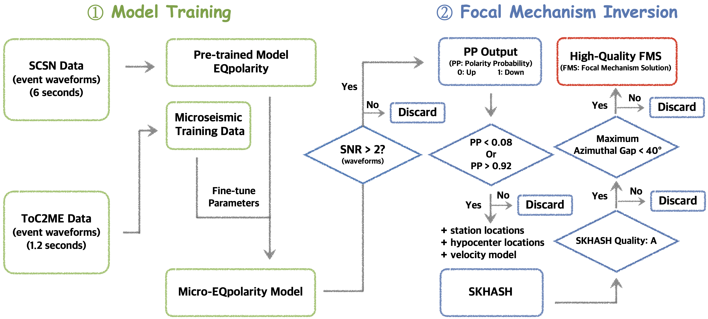
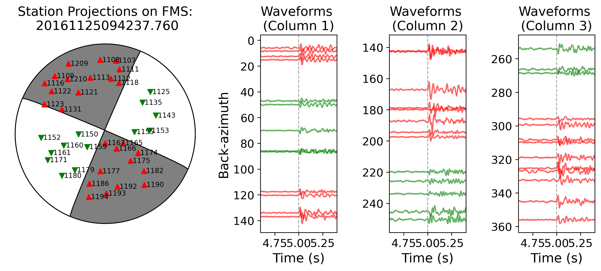
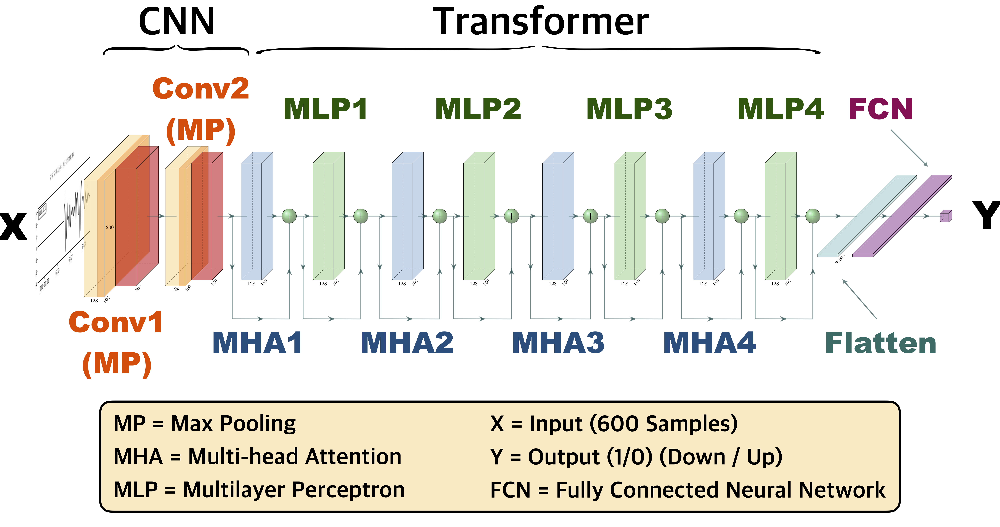
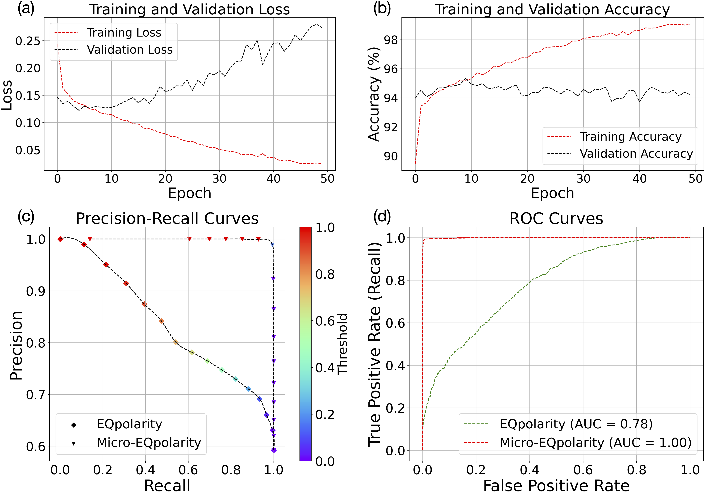
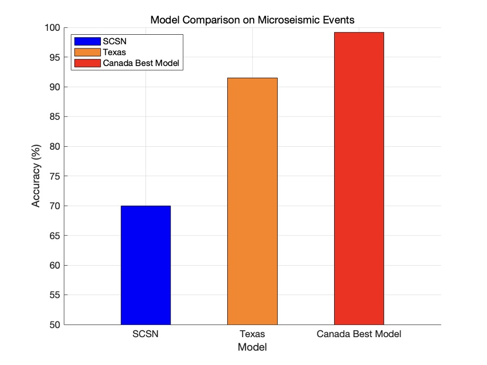

# Micro-EQpolarity
**Micro-EQpolarity** is Jiachen Hu's code repository for polarity picking and focal mechanism analyses in Canada.

<div style="text-align: center;">
  
  <p><b>Figure 1:</b> (a) Regional map of the ToC2ME study area (red box) in Alberta. (b) Map of the ToC2ME monitoring configuration with 69 stations, recording 21,619 events in ML -2.19 to 3.21.</p>
</div>

## Overview
This repository provides a comprehensive set of tools and workflows for working with the ToC2ME dataset. The main sections of this repository are:

## 1. HASH Workflow

### Description

This section includes the process for solving focal mechanisms using SKHASH on the ToC2ME dataset. Users can choose to either manually pick polarities or utilize the EQpolarity model for automatic Micro-EQpolarity picking.

<div style="text-align: center;">
  
  <p><b>Figure 2:</b> Workflow for calculating focal mechanisms of microseismic events using transfer learning to adapt the EQpolarity model to microseismic P-wave first-motion polarity determination.</p>
</div>

See [Code_ToC2ME/HASH_Workflow/Automatically_EQpolarity/README.md](https://github.com/hhhjjjcc/Micro-EQpolarity/blob/main/Code_ToC2ME/HASH_Workflow/Automatically_EQpolarity/README.md) and [Code_ToC2ME/HASH_Workflow/Manually/README.md](https://github.com/hhhjjjcc/Micro-EQpolarity/blob/main/Code_ToC2ME/HASH_Workflow/Manually/README.md) for run instructions.

---

## 2. Plot Waveforms on Focal Mechanisms

### Description
This section provides a script that enables users to plot waveforms directly with focal mechanism beachball diagrams. This feature helps validate the correctness of the mechanism solutions by allowing users to check waveforms and station locations.

- Generated by [Code_ToC2ME/Plot_waveform_on_mechanisms/Focal_mechanism_with_waveform_20241117_skhash.py](https://github.com/hhhjjjcc/Micro-EQpolarity/blob/main/Code_ToC2ME/Plot_waveform_on_mechanisms/Focal_mechanism_with_waveform_20241117_skhash.py)
<div style="text-align: center;">
  
  <p><b>Figure 3:</b> An example of an FMS with a magnitude of -1.07 and its corresponding polarity classification results as a function of back-azimuth.</p>
</div>

### Notes:
- In the ToC2ME dataset, waveform polarities are inverted.

---

## 3. EQpolarity Transfer Learning

### Description
This section demonstrates the application of transfer learning using EQpolarity models on the ToC2ME dataset.

<div style="text-align: center;">
  
  <p><b>Figure 4:</b> Architecture of the EQpolarity neural network for P-wave first-motion polarity determination.</p>
</div>

- Generated by [Code_ToC2ME/EQpolarity_Transfer_Learning/Training_Validation_curves.py](https://github.com/hhhjjjcc/Micro-EQpolarity/blob/main/Code_ToC2ME/EQpolarity_Transfer_Learning/Training_Validation_curves.py) and [Code_ToC2ME/EQpolarity_Transfer_Learning/CCT_ToC2ME_TransferLearning_20240926_For_Test_update20241013.ipynb](https://github.com/hhhjjjcc/Micro-EQpolarity/blob/main/Code_ToC2ME/EQpolarity_Transfer_Learning/CCT_ToC2ME_TransferLearning_20240926_For_Test_update20241013.ipynb)
<div style="text-align: center;">
  
  <p><b>Figure 5:</b> Learning curves of Micro-EQpolarity trained on ToC2ME data, showing (a) loss and (b) accuracy for both training and validation sets with a threshold of 0.5. The best model is the one from epoch 9. Performance evaluation includes (c) precision-recall curves (d) ROC curves on ToC2ME test set.</p>
</div>

- Accuracy on Microseismic Events (ToC2ME)
Accuracy for each model can be obtained from [Code_ToC2ME/EQpolarity_Transfer_Learning/CCT_ToC2ME_TransferLearning_20240926_For_Test_update20241013.ipynb](https://github.com/hhhjjjcc/Micro-EQpolarity/blob/main/Code_ToC2ME/EQpolarity_Transfer_Learning/CCT_ToC2ME_TransferLearning_20240926_For_Test_update20241013.ipynb).
The models are as follows:
1. Blue: [model/SCSN/best_weigths_Binary_SCSN_Best.h5](https://github.com/hhhjjjcc/Micro-EQpolarity/blob/main/model/SCSN/best_weigths_Binary_SCSN_Best.h5)
2. Orange: [model/Texas/best_weigths_Binary_Texas_Transfer10.h5](https://github.com/hhhjjjcc/Micro-EQpolarity/blob/main/model/Texas/best_weigths_Binary_Texas_Transfer10.h5)
3. Red (Micro-EQpolarity): [model/Toc2me_20240819_Transfer_Learning_21916data/best_weigths_Binary_Toc2me_Transfer_SCSN_20241013_21916data_90.h5](https://github.com/hhhjjjcc/Micro-EQpolarity/blob/main/model/Toc2me_20240819_Transfer_Learning_21916data/best_weigths_Binary_Toc2me_Transfer_SCSN_20241013_21916data_90.h5)
<div style="text-align: center;">
  
  <p><b>Figure 6:</b> Accuracy on the ToC2ME test dataset.</p>
</div>

- Inference demo: [Code_ToC2ME/EQpolarity_Transfer_Learning/run_eqpolarity_ToC2ME.ipynb](https://github.com/hhhjjjcc/Micro-EQpolarity/blob/main/Code_ToC2ME/EQpolarity_Transfer_Learning/run_eqpolarity_ToC2ME.ipynb) loads the trained Micro-EQpolarity weights with a relative path (`../../model/Toc2me_20240819_Transfer_Learning_21916data/best_weigths_Binary_Toc2me_Transfer_SCSN_20241013_21916data_90.h5`), reads waveforms listed in `../HASH_Workflow/all_data_demo/catalog_sorted_ToC2ME.txt` together with station coordinates from `../HASH_Workflow/all_data_demo/stationlist_ToC2ME.txt`, and writes one `.polarity` file per event into `result_ToC2ME_eqpolarity/` inside the same folder. See the folder README for details.

---

## Data
1. ToC2ME all waveforms: https://doi.org/10.5281/zenodo.14185578

2. ToC2ME 2519 FMSs waveforms: https://doi.org/10.5281/zenodo.15165318

3. Texas data: Google Drive link: https://drive.google.com/drive/folders/1WXVB8ytNB4bOaZ97oq6OmMRyAEg95trp?usp=sharing

4. Texas_22980 data: https://doi.org/10.5281/zenodo.13901460

5. ToC2ME_Testing_data: in the `data/ToC2ME_Testing_data_for_model_20241022` folder (`datall.npy`, `polall.npy`).

6. Final ToC2ME focal mechanism catalog: `data/Data_Set_S1.txt` (columns: `origin_time evla evlo depth strike dip rake evid mag`; 2526 data rows plus one header row). This is the complete, final FMS catalog for the ToC2ME study.

7. Demo inference data: `Code_ToC2ME/HASH_Workflow/all_data_demo/` (3 sample events, `catalog_sorted_ToC2ME.txt`, and `stationlist_ToC2ME.txt` with columns `station_id network longitude latitude`).

---

## Environment Setup

To create and set up the required environment, follow these steps:

```bash
# Step 1: Create a Conda environment with Python 3.11.7
conda create -n eqp python=3.11.7

# Step 2: Activate the Conda environment
conda activate meqp

# Step 3: Install Jupyter Notebook
conda install ipython notebook

# Step 4: Install additional dependencies
pip install matplotlib==3.8.0 tensorflow==2.14.0 scikit-learn==1.2.2 seaborn==0.13.2

# optional
# obspy
conda install -c conda-forge obspy

# openpyxl
conda install openpyxl
```
---

## Reference
1. Chen Y, Saad OM, Savvaidis A, Zhang F, Chen Y, Huang D, Li H, Zanjani FA, 2024, Deep learning for P-wave first-motion polarity determination and its application in focal mechanism inversion. IEEE Transactions on Geoscience and Remote Sensing, 62, 5917411.
2. Skoumal, R.J., Hardebeck, J.L., Shearer, P.M. (2024). SKHASH: A Python package for computing earthquake focal mechanisms. Seismological Research Letters, 95(4), 2519-2526. https://doi.org/10.1785/0220230329
3. Fangxue Zhang, Ruijia Wang, Yunfeng Chen, and Yangkang Chen. Spatiotemporal variations in earthquake triggering mechanisms during multistage hydraulic fracturing in western Canada. Journal of Geophysical Research: Solid Earth, 127, 08 2022. doi: 10.1029/2022JB024744.
4. Weiqiang Zhu, Gregory C Beroza, PhaseNet: a deep-neural-network-based seismic arrival-time picking method, Geophysical Journal International, Volume 216, Issue 1, January 2019, Pages 261–273, https://doi.org/10.1093/gji/ggy423
